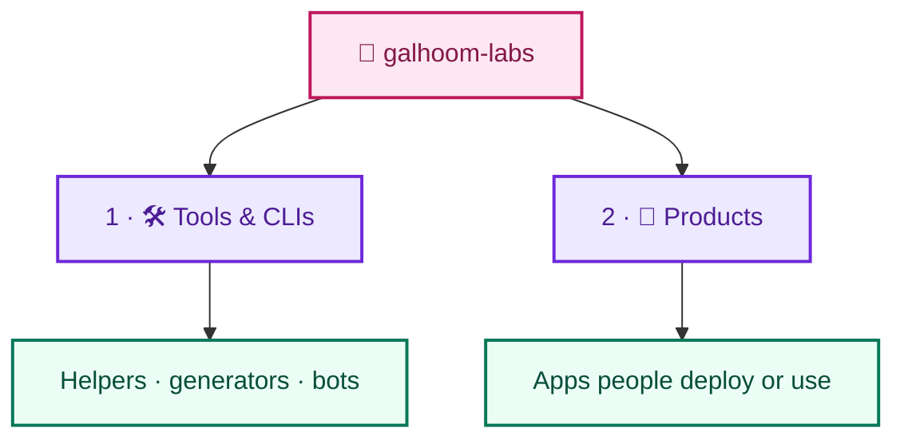

# Galhoom Labs

**Build and share useful things.**

This organization is for **real, usable work**: tools, CLIs, and products that help people — even if you never follow Galhoom Path.

| This org IS | This org is NOT |
|---|---|
| Tools & CLIs | A study curriculum |
| Real products / SaaS starters | Interview / DSA practice |
| Helpers, generators, bots | Track 1–5 learning repos |
| Apps people deploy or use | Practice-only apps |

Learning roadmap lives in **[galhoom-path](https://github.com/galhoom-path)**.

**[Open galhoom-path →](https://github.com/galhoom-path)** · Learn and progress

**Promise in one line:** Path = learn. Labs = ship useful things.
