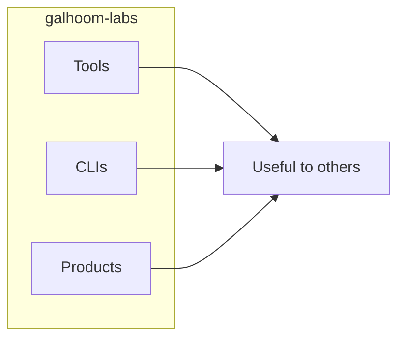

# Galhoom Labs

**Build and share useful things.**

Real tools, CLIs, and products — things people can use.

> Learning and practice stay in **[galhoom-path](https://github.com/galhoom-path)**.

| | |
|---|---|
| **Promise** | Build and share useful things |
| **For now** | Tools · CLIs · Products |
| **Not here (yet)** | Libraries · Templates — deferred until the scope is clearer |
| **Learning** | → [galhoom-path](https://github.com/galhoom-path) |

New repos land here when the pitch is *use this*, not *follow the path*.
