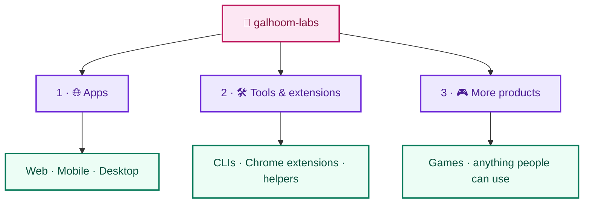

# Galhoom Labs

**Build and share real products.**

This organization is for **real things people can use** — not a study path.

If you open **galhoom-labs**, you are here for **products**: websites, mobile apps, desktop apps, Chrome extensions, CLIs, games, or any other form — as long as someone can open it, install it, or run it and get value.

| This org IS | This org is NOT |
|---|---|
| Real products others can use | A learning curriculum |
| Web · Mobile · Desktop apps | Study / foundations tracks |
| CLIs, extensions, helpers | Interview / DSA practice |
| Games & other usable products | Practice-only learning builds |

### Projects in this org

Repos here are **real products**.

- **Goal:** use and benefit — open it, install it, run it, ship value.
- Web, mobile, desktop, extensions, CLIs, games, or any other usable form.
- Mindset: *“I built this for people to use.”*

Practice / applied projects whose only job is learning stay in **[galhoom-path](https://github.com/galhoom-path)**.

How it works:
1. **Pitch is “use this”** → it belongs here.
2. **Pitch is “study this / get your hands dirty”** → it belongs in **[galhoom-path](https://github.com/galhoom-path)**.
3. A practice project stays on Path until it becomes a real product people rely on — then the product home is Labs.

**Siblings:** Path and Labs complete each other — Path grows developers; Labs ships real products. A request that belongs in the other org should be redirected, not forced here.

**[Open galhoom-path →](https://github.com/galhoom-path)** · Learn and progress

**Promise in one line:** Path = learn & grow (practice projects). Labs = real products.
